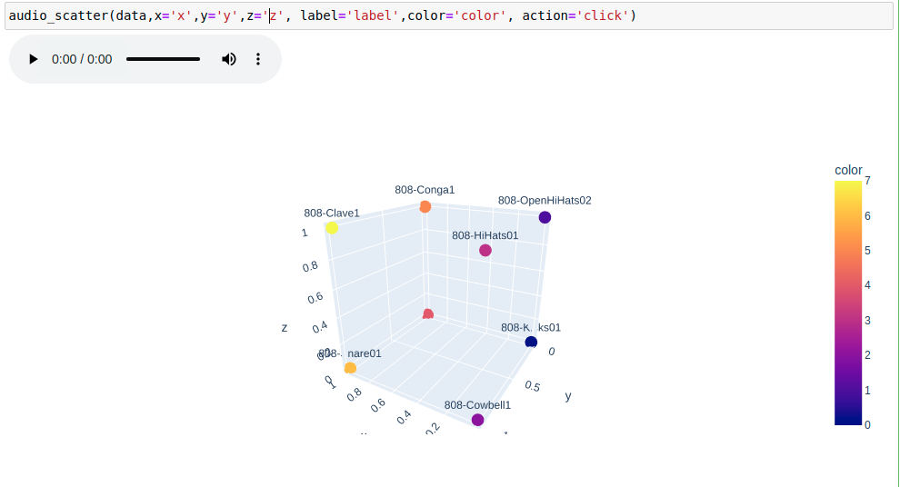

# Audio Scatter

An interactive visualization tool that allows you to play audio samples by clicking on points in a scatterplot within Jupyter notebooks. Perfect for exploring audio datasets, sound libraries, or any collection of audio samples in a visual way.

## Features

- Interactive scatterplot visualization of audio samples
- Click-to-play functionality
- Support for both Plotly and Matplotlib backends
- Easy integration with pandas DataFrames
- Customizable plot aesthetics (colors, labels, etc.)

## Installation

```bash
pip install .
```

## Quick Start

```python
from audio_scatter.plotly import audio_scatter

# Prepare your data DataFrame with columns for:
# - x, y: coordinates for the scatter plot
# - audio_path: path to audio files
# - label (optional): labels for the points
# - color (optional): colors for the points

audio_scatter(
    data,
    x='x',
    y='y',
    audio_path='audio_path',  # column containing paths to audio files
    label='label',           # optional: column for point labels
    color='color',          # optional: column for point colors
    action='click'         # trigger action ('click' or 'hover')
)
```



## Usage Examples

Check out our example notebooks:
- `Demo.ipynb`: Modern example using Plotly backend
- `DemoLegacy.ipynb`: Example using Matplotlib backend

## Requirements

- Python ≥ 3.8
- Key dependencies:
  - plotly
  - pandas
  - numpy
  - matplotlib
  - seaborn
  - ipython
  - ipywidgets

## Legacy Matplotlib Backend

If you prefer using the Matplotlib backend with widget support, you'll need to set up ipympl:

```bash
pip install ipympl
jupyter nbextension install --py ipympl
jupyter nbextension enable --py ipympl
```

Then in your notebook, use:
```python
%matplotlib widget  # instead of %matplotlib notebook
```

## Contributing

Contributions are welcome! Please feel free to submit a Pull Request.

## License

This project is licensed under the MIT License.
